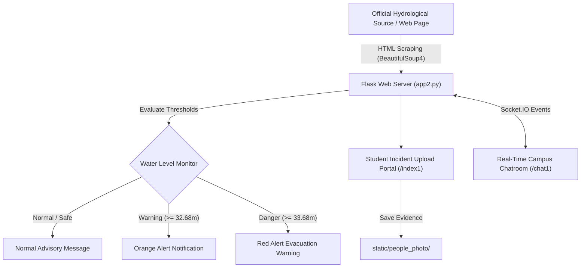

# 🌊 Campus Flood Alert and Management System (IIIT Bhagalpur)

[](https://www.python.org/)
[](https://flask.palletsprojects.com/)
[](https://flask-socketio.readthedocs.io/)
[](https://www.crummy.com/software/BeautifulSoup/)
[](https://getbootstrap.com/)

A web-based flood monitoring and emergency response portal developed for **IIIT Bhagalpur**. The system tracks real-time Ganga river water levels via web scraping, alerts campus residents against critical warning thresholds, allows students to submit field photo reports of waterlogging/damage, and provides a real-time WebSocket chat room for campus emergency communication.

---

## 📌 Problem & Motivation

IIIT Bhagalpur is situated in close proximity to the Ganga river basin, making the campus and surrounding areas vulnerable to seasonal waterlogging and high flood levels during monsoon periods. 

This portal serves as an integrated communication and alert dashboard to:
1. **Track Water Levels**: Automatically extract the latest water level data from official hydrological monitoring bulletins.
2. **Classify Danger Levels**: Compare current levels against predefined hydrologic benchmarks (Warning Level, Danger Level, Highest Flood Level).
3. **Student Field Reporting**: Enable students and faculty to upload timestamped incident photos showing local waterlogging or infrastructure hazards.
4. **Emergency Chat**: Provide an instant, multi-user WebSocket-powered community room for real-time coordination during adverse weather conditions.

---

## 🏗️ System Architecture



---

## ⚡ Key Features

- **Automated Web Scraping**: Parses river water level figures using `BeautifulSoup4` from hydrological HTML bulletins.
- **Dynamic Status Ticker**: Real-time marquees highlighting current water status against key hydrological benchmarks:
  - **Warning Level**: `32.68 m`
  - **Danger Level**: `33.68 m`
  - **Highest Flood Level (HFL)**: `34.72 m`
- **Issue Photo Uploads**: Secure file upload handling (`secure_filename`) supporting `.png`, `.jpg`, `.jpeg`, and `.gif` with instantaneous preview for administrative action.
- **Campus Emergency Chat**: Full-duplex bidirectional messaging powered by `Flask-SocketIO` and jQuery for coordinating on-ground assistance and relief.

---

## 📂 Repository Structure

```text
Flood_Alert_and_Management_System_for_Campus_Using_Webscraping/
├── README.md
└── newwebscrape/
    ├── app2.py                     # Main Flask backend & Socket.IO server
    ├── templates/
    │   ├── index1.html             # Flood dashboard, warning indicators & file upload form
    │   └── chat1.html              # Real-time WebSocket emergency chatroom
    └── static/
        └── people_photo/           # Image assets, logo, background, & user-uploaded reports
            ├── bgplogo.png         # IIIT Bhagalpur branding
            ├── bgpback12.jpg       # Background styling
            └── style.css           # Custom presentation styling
```

---

## 🚀 Getting Started

### Prerequisites

- **Python 3.8+**
- `pip` package manager

### 1. Clone the Repository
```bash
git clone https://github.com/BoniAshok/Flood_Alert_and_Management_System_for_Campus_Using_Webscraping.git
cd Flood_Alert_and_Management_System_for_Campus_Using_Webscraping/newwebscrape
```

### 2. Install Dependencies
```bash
pip install flask beautifulsoup4 flask-socketio werkzeug
```

### 3. Run the Application
```bash
python app2.py
```

The application will launch on `http://localhost:5000`:
- **Main Flood Dashboard & Upload Portal**: `http://localhost:5000/`
- **Campus Emergency Chat**: `http://localhost:5000/chat1`

---

## 🛠️ Built With

- **Backend**: [Flask](https://flask.palletsprojects.com/)
- **Web Scraping**: [Beautiful Soup 4](https://www.crummy.com/software/BeautifulSoup/)
- **Real-Time Communication**: [Flask-SocketIO](https://flask-socketio.readthedocs.io/)
- **Frontend**: HTML5, CSS3, JavaScript, [jQuery](https://jquery.com/), [Bootstrap 3](https://getbootstrap.com/)
- **File Handling**: Werkzeug

---

## 🤝 Contributing

Contributions, issues, and feature requests are welcome! Feel free to check the [issues page](https://github.com/BoniAshok/Flood_Alert_and_Management_System_for_Campus_Using_Webscraping/issues).
